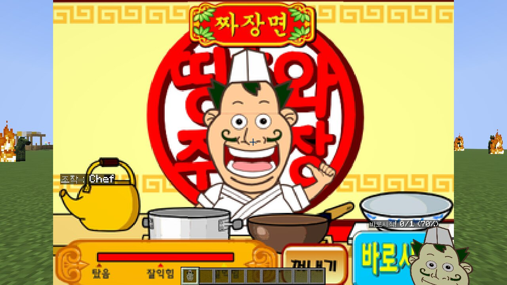
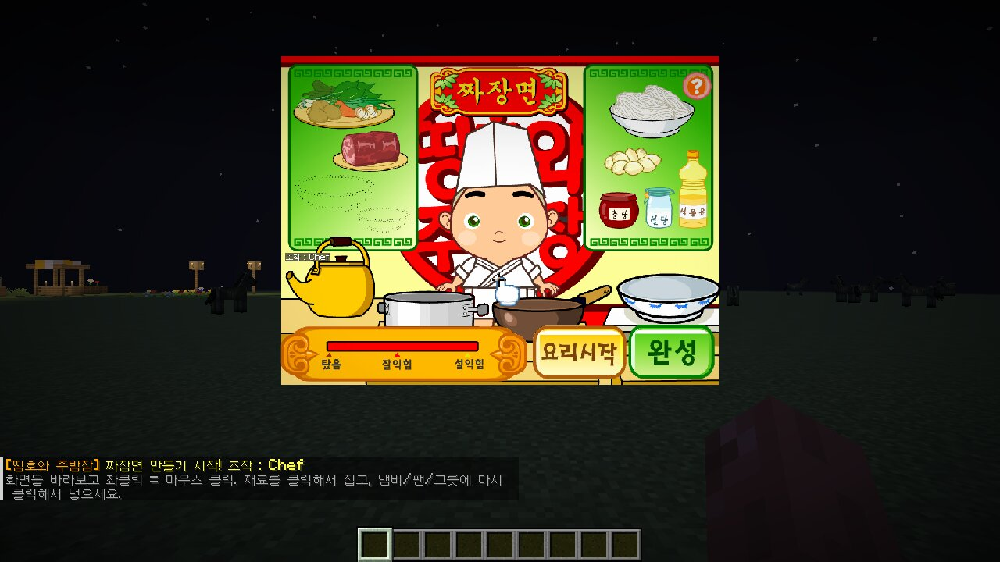
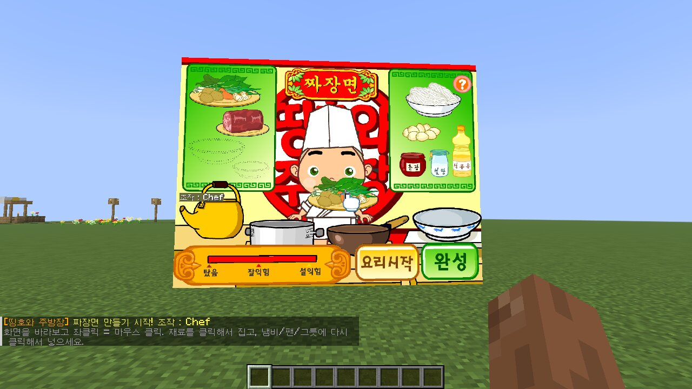
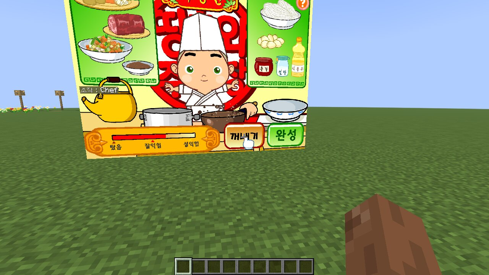
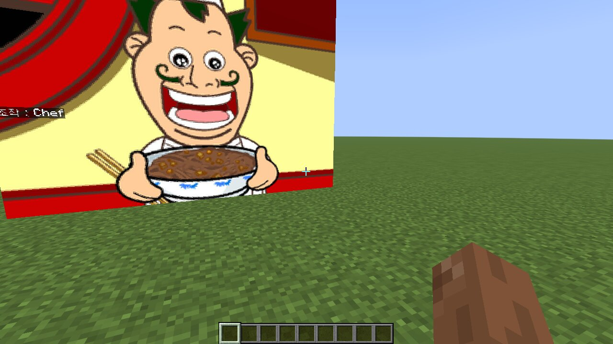
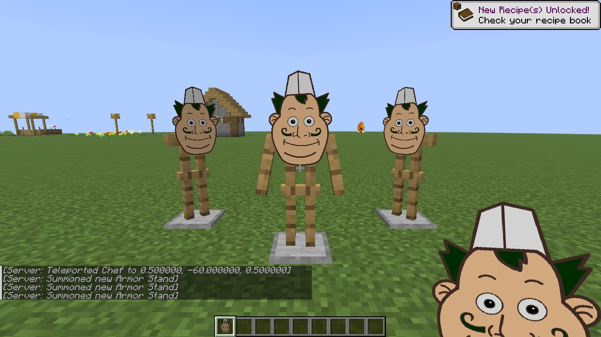

# 띵호와 주방장1 — 짜장면 만들기 (마인크래프트 26.3)

[game-kingdom.tistory.com/256](https://game-kingdom.tistory.com/256)에 올라온 플래시 게임 **「띵호와 주방장1 짜장면 만들기」**를
SWF에서 추출·분석해서 **Paper 26.3 서버 플러그인 + 리소스팩**으로 다시 만든 프로젝트입니다.

- 브라우저나 플래시 에뮬레이터를 쓰지 않습니다. 게임 로직은 원본 ActionScript를 디컴파일해 Java로 옮겼고, 그림과 소리는 모두 리소스팩에 들어 있습니다.
- 명령어로 시작합니다. SayHi 로고와 커튼·타이틀 인트로는 생략하고, 커튼이 열린 메뉴 화면부터 **주방장 시연**(약 103초, 내레이션 포함)이 게임 안에서 재생됩니다.
- 시연 중에는 **접속자 전체의 70%가 화면의 「바로시작!」 버튼을 클릭하면** 시연을 건너뛰고 바로 요리가 시작됩니다. 투표 현황(예: `바로시작! 2/3 (70%)`)이 버튼 위에 표시되고, 누가 눌렀는지 채팅으로 알려 줍니다. 시연이 끝까지 재생돼도 자동으로 게임이 시작됩니다.
- 게임 화면의 **세로 크기가 클라이언트 화면 세로에 꼭 맞도록** 조작자 눈높이·거리를 자동으로 계산해 세웁니다(기본 FOV 70 기준).
- 마우스를 움직이고 클릭하는 **조작자는 1명**입니다(시연 중 「바로시작!」 투표는 모든 플레이어가 할 수 있습니다). 좌측 상단 원래 게임 UI(재료 패널) 아래에 **`조작 : (플레이어명)`** 이 표시됩니다.
- 보너스로 **띵호와 주방장 가면**이 들어 있습니다. 얼굴 앞에 평면으로 붙고, 머리보다 큰 전체 얼굴(모자 포함) 모양입니다.

▶ **플레이 영상**: [`docs/ddinghowa_gameplay.mp4`](docs/ddinghowa_gameplay.mp4) — 실제 26.3 클라이언트로 녹화했습니다(시연 → 「바로시작!」 투표 → 요리 → 400점 완벽 엔딩 → 다시하기). 소리는 서버의 효과음 재생 기록으로 합성했습니다.

| 시연 (바로시작! 투표) | 게임 화면 | 드래그 | 조리 중 |
|---|---|---|---|
|  |  |  |  |

| 엔딩 | 주방장 가면 |
|---|---|
|  |  |

(스크린샷은 실제 26.3 클라이언트로 이 플러그인 서버에 접속해서 찍었습니다.)

## 설치

1. `dist/DdinghowaChef-1.0.0.jar` 를 Paper **26.3** 서버(Java 25)의 `plugins/` 에 넣고 서버를 켭니다.
2. 리소스팩은 플러그인이 접속하는 플레이어에게 자동으로 보냅니다.
   - 플러그인 내장 HTTP 서버가 **8163 포트**에서 팩을 제공합니다. 외부 플레이어가 받으려면 이 포트를 열어 주세요(방화벽·포트포워딩).
   - 직접 호스팅하려면 `dist/ddinghowa_pack.zip`(서버 실행 시 `plugins/DdinghowaChef/` 에도 복사됨)을 올리고,
     `config.yml` 의 `resource-pack.public-url` 에 주소를 넣거나 `server.properties` 의 `resource-pack` 으로 배포하세요.

## 명령어

`/ddinghowa` (별칭 `/jjajang`, `/띵호와`)

| 명령어 | 설명 |
|---|---|
| `/ddinghowa start [플레이어]` | 그 플레이어(생략 시 본인) 앞에 게임 화면을 세우고 시작합니다. 그 플레이어가 조작자가 됩니다. 콘솔에서는 플레이어 이름이 필요합니다. |
| `/ddinghowa stop` | 게임을 끝내고 화면을 치웁니다. |
| `/ddinghowa restart` | 처음(시연)부터 다시 시작합니다. |
| `/ddinghowa skip` | 시연을 강제로 건너뜁니다(관리자용, 평소엔 70% 투표). |
| `/ddinghowa control <플레이어>` | 조작자를 바꿉니다(`조작 :` 표시도 바뀝니다). |
| `/ddinghowa mask [플레이어]` | 띵호와 주방장 가면을 줍니다(우클릭으로 착용). |
| `/ddinghowa pack` | 리소스팩을 다시 받습니다. |

권한: `ddinghowa.admin`(시작/종료/조작자, 기본 OP), `ddinghowa.mask`(가면, 기본 OP)

## 조작법

- 화면을 바라보면 시선(크로스헤어)이 곧 마우스입니다. 원본의 손 모양 커서가 따라다닙니다.
- **좌클릭 = 마우스 클릭** (우클릭도 똑같이 동작)
- 재료는 **클릭해서 집고**, 냄비·팬·그릇 위에서 **다시 클릭해서 놓습니다**. 원본의 드래그 앤 드롭과 같습니다.
- 다른 플레이어는 화면을 구경할 수 있습니다. 소리는 화면 근처에 있는 사람에게 들립니다.

### 짜장면 레시피 (원본 로직 기준, 만점 400점)

1. 야채(＋고기)를 **팬**에 넣고 「요리시작」 → 게이지가 「잘익힘」 근처일 때 「꺼내기」 → 야채볶음
2. 춘장을 **팬**에 넣고 볶기 → 볶음춘장
3. 야채볶음 접시와 볶음춘장 접시를 **팬**에 넣고 볶기 → 짜장 (100점 + 익힘 점수)
4. 주전자(물)와 면을 **냄비**에 넣고 삶기 → 면 (100점 + 익힘 점수)
5. 면 접시와 짜장 접시를 오른쪽 **그릇**에 넣고 「완성」
6. 점수에 따라 엔딩 3종: 350점 초과면 대성공, 280점 초과면 보통, 그 외는 실패. 엔딩 끝의 「다시하기」를 누르면 다시 시작합니다.

익힘 점수는 원본 게이지 프레임으로 계산합니다. 111~200프레임(시작 후 약 3.7~6.7초)이 100점이고, 너무 오래 익히면 탄 음식(그림도 탄 것으로 바뀜)이 됩니다.

## 설정 (`plugins/DdinghowaChef/config.yml`)

- `screen.fit-to-view` — 화면 세로를 클라이언트 화면에 맞춤(기본 켜짐). 조작자 눈높이에 화면 중심을 두고, `screen.fov`(기본 70) 시야에 맞는 거리를 계산합니다. 클라이언트에서 FOV를 바꿨다면 같은 값으로 맞추세요.
- `screen.width` — 화면 가로 길이(블록, 기본 4). 화면이 땅에 묻히지 않도록 약 4.18까지만 적용됩니다.
- `control.lock-controller` — 조작자를 제자리에 고정합니다(기본 켜짐, 시야 맞춤 유지용). 시선은 자유롭게 움직일 수 있습니다.
- `resource-pack.*` — 자동 전송, 포트, 외부 URL, 필수 여부
- `sound.*` — 효과음 켜기/끄기, 볼륨

## 구현 내용

### 1. 게임 추출·분석
- 블로그 글에서 SWF(`original/ddinghowa1.swf`, 550×413, 30fps, AS2)를 추출했습니다.
- 직접 만든 SWF 파서와 AS2 디컴파일러(`tools/extract/swflib.py`)로 전체 스크립트를 풀었습니다 → `docs/decompiled_actionscript.txt`
  - 메인 타임라인: 1~3 프리로더, 4 로고, 5~828 인트로, 829 도움말 정의, **3266 게임 시작**(「바로시작!」 버튼 목적지), 3278 조작 대기, 3304/3889/4401 엔딩
  - 핵심 함수: `CheckCooking`, `PutInMeterial`, `SetIntV`/`IntervalLoop`, `MetaGauge`, `DecoAction`, `CookMeterial`(점수), `DishLader`, `MakeFood`, `GotoEnding`
- `KitchenGame.java` 는 이 함수들을 같은 이름·같은 분기로 옮긴 것입니다. SWF6에서 `undefined` 가 0으로 계산되는 동작까지 맞췄습니다.

### 2. 이미지 → 리소스팩
- 게임 사전(dictionary)만 담은 미니 SWF를 만들어, 각 오브젝트를 원하는 프레임으로 고정한 뒤 투명 배경으로 1.5배 렌더링했습니다(`tools/extract/mini.py`, `assets.py`, `cap.js`).
  - 배경, 주방장(50프레임), 재료 8종(보통/호버), 접시(빈 접시·야채볶음·면·춘장·짜장 × 정상/탄 것 × 호버), 냄비(물·면·끓기 애니메이션·주전자 붓기), 팬(붓기 6종·볶기 6종 애니메이션), 그릇 4단계, 게이지, 버튼 호버, 화살표, 도움말, 커서
  - 엔딩 3종은 저프레임 슬라이드와 마지막 장면(고해상도)으로 넣었습니다.
  - 시연(프레임 170~3265)은 SWF 재생 속도를 1/7.5로 늦춰 6프레임마다 정확히 캡처한 뒤(초당 5장), 키프레임과 바뀐 영역만 잘라 낸 조각으로 압축했습니다. 시연 내레이션 스트림과 배경음도 함께 들어 있습니다.
- 효과음 27개(재료 호버, 붓기, 볶기, 끓기, 금지음, 완성음, 배경음, 엔딩 스트림 음악)를 SWF의 MP3/ADPCM에서 OGG로 변환했습니다.
- 각 이미지는 `ddinghowa:<id>` 아이템 모델이고, 서버는 `item_display` 엔티티를 레이어별로 겹쳐 원본 화면을 그립니다.

### 3. 밝기 보정
26.3 클라이언트는 아이템 면의 법선으로 음영을 넣기 때문에, 그냥 세운 평면은 약 74%(동서 방향은 50%) 밝기로 어둡게 보입니다.
스프라이트 모델을 50° 기울여 구운 법선이 위쪽(UP)으로 스냅되게 하고, 디스플레이 변환으로 다시 세우면서 두께 방향을 크게 늘렸습니다.
그래서 법선은 위를 향한 채로 남고 화면은 수직이 되며, 밤이나 어느 방향에서도 원본 색 그대로 보입니다(`Screen.java` 주석 참고).

## 다시 빌드하기

```bash
# 플러그인 (Java 25)
mvn package        # → target/DdinghowaChef-1.0.0.jar

# 리소스팩/에셋 재생성 (선택)
#  1) tools/extract/cap.html 과 같은 폴더에 Ruffle 셀프호스트 파일(npm @ruffle-rs/ruffle)을 두고 HTTP 서버 실행
#  2) python3 tools/extract/assets.py original/ddinghowa1.swf <web폴더> <캡처폴더> → node tools/extract/cap.js <jobs.json>
#  3) python3 tools/extract/build_pack.py original/ddinghowa1.swf <캡처폴더> <엔딩캡처폴더> tools/extract/mask_head.png build
#  4) build/assets.json, build/ddinghowa_pack.zip 을 src/main/resources/ 로 복사
```

※ 원본 게임의 저작권은 원저작자(SayHi Kids)에게 있습니다. 개인·비영리 서버에서 즐기는 용도로 만들었습니다.
