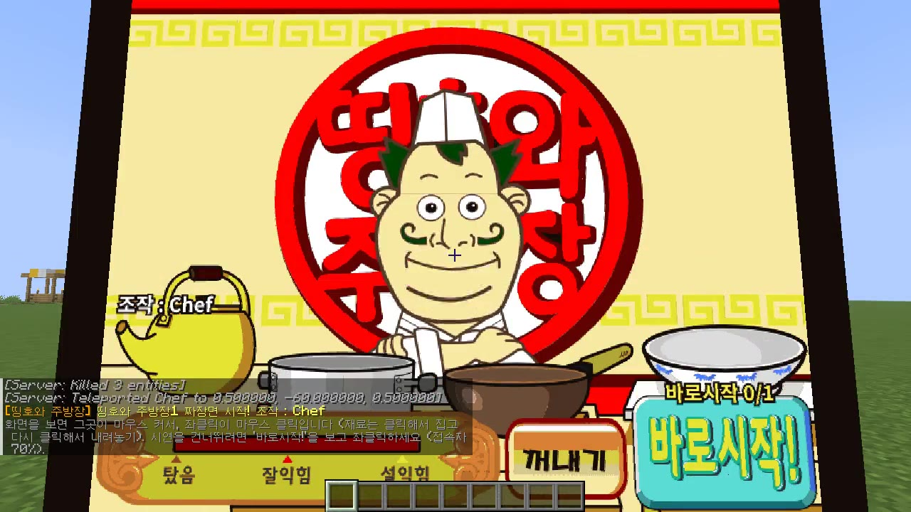
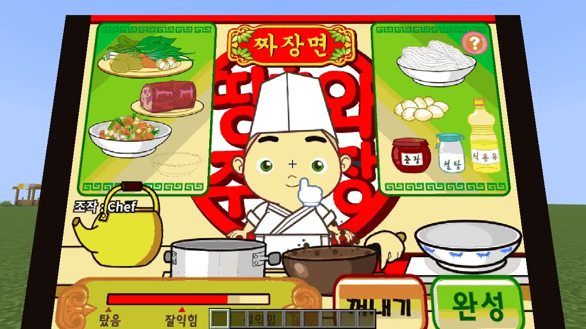
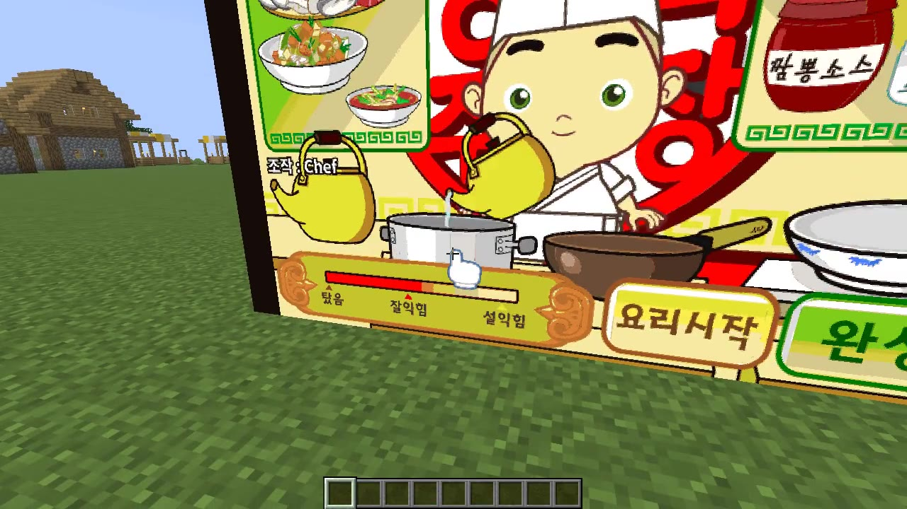
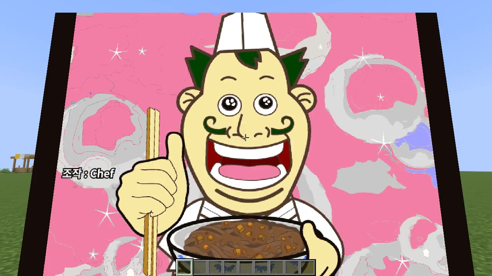
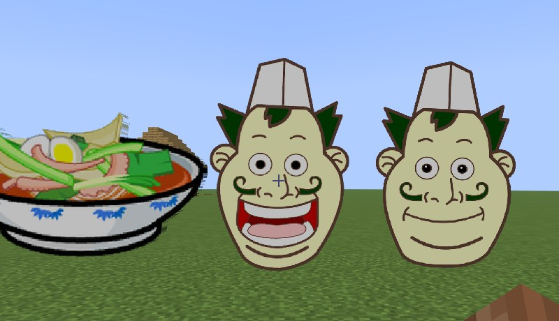

# 띵호와 주방장 1·2 — 짜장면 / 짬뽕 만들기 (마인크래프트 26.3)

game-kingdom.tistory.com 에 올라온 플래시 게임 두 개를 **원본 SWF 그대로 서버에서 실행**해서 마인크래프트 안 화면으로 보여 주는 Paper 26.3 플러그인입니다.

| 번호 | 게임 | 원본 |
|---|---|---|
| 1 | 띵호와 주방장1 **짜장면** 만들기 | [game-kingdom.tistory.com/256](https://game-kingdom.tistory.com/256) |
| 2 | 띵호와 주방장2 **짬뽕** 만들기 | [game-kingdom.tistory.com/257](https://game-kingdom.tistory.com/257) |

- **플래시 게임 연결 방식**: 서버 컴퓨터에서 헤드리스 크롬 + [Ruffle](https://ruffle.rs)(플래시 에뮬레이터)로 원본 SWF를 실행하고, 그 화면을 **지도 24장(6×4)짜리 화면 벽**으로 실시간 전송합니다. 게임 로직·그림·애니메이션은 모두 원본 그대로입니다.
- 화면 벽은 조작자 바로 앞에, **화면 세로가 클라이언트 시야(FOV 70)에 꼭 맞는 거리**로 세워집니다.
- 게임 중에는 **플레이어 손이 보이지 않습니다**. 커서는 원본 게임의 손가락 커서가 화면 안에 그대로 나옵니다.
- 명령어로 시작합니다. SayHi 로고·커튼 인트로는 생략하고, 메뉴 화면부터 **주방장 시연**이 게임 안에서 재생됩니다.
- 시연 중에는 **접속자 전체의 70%가 「바로시작!」을 클릭하면** 시연을 건너뜁니다. 투표 현황(`바로시작 2/3`)이 버튼 위에 뜨고, 누가 눌렀는지 채팅으로 알려 줍니다.
- 마우스를 움직이고 클릭하는 **조작자는 1명**이고, 좌측 상단 재료 패널 아래에 **`조작 : (플레이어명)`** 이 표시됩니다. 다른 플레이어는 같은 화면을 구경합니다.
- 리소스팩은 **가면 / 고개 흔드는 주방장 / 짬뽕 스프라이트 / 손 숨기기**만 담은 약 **0.5MB** 입니다 (이전 버전 46MB).
- 보너스: **띵호와 주방장 가면**, **심사 장면 주방장 고개 흔들기 애니메이션**(PNG + 딜레이 명시 파일 + 누끼 GIF).

▶ 플레이 영상 (실제 26.3 클라이언트, 시연 → 「바로시작!」 투표 → 요리 → 심사·엔딩 → 다시하기):
[`docs/ddinghowa1_jjajang_flash.mp4`](docs/ddinghowa1_jjajang_flash.mp4) · [`docs/ddinghowa2_jjamppong_flash.mp4`](docs/ddinghowa2_jjamppong_flash.mp4)
(지도 화면에는 소리가 실리지 않아 무음입니다)

| 시연 · 바로시작! 투표 | 짜장면 | 짬뽕 |
|---|---|---|
|  |  |  |

| 심사 (고개 흔드는 주방장) | 리소스팩 아이템 (짬뽕 / 고개 흔드는 주방장 / 가면) | 주방장 가면 착용 |
|---|---|---|
|  |  |  |

## 설치

1. `dist/DdinghowaChef-1.0.0.jar` 를 Paper **26.3** 서버(Java 25)의 `plugins/` 에 넣습니다.
2. **서버 컴퓨터에 크롬(또는 크로미움 / 엣지)** 이 있어야 합니다. 화면이 없는 리눅스 서버도 됩니다(헤드리스).
   - 흔한 설치 위치와 `CHROME_PATH` 환경변수에서 자동으로 찾습니다. 못 찾으면 `config.yml` 의 `browser.path` 에 실행 파일 경로를 적으세요.
   - 예) 우분투 `sudo apt install chromium` 또는 구글 크롬 설치, 윈도우 `C:\Program Files\Google\Chrome\Application\chrome.exe`
   - 크롬은 게임 중에만 켜지고(`--headless`), 플러그인 jar 안의 페이지만 루프백(127.0.0.1)으로 엽니다. 외부 인터넷 접속은 필요 없습니다.
3. 서버를 켜면 리소스팩을 접속하는 플레이어에게 자동으로 보냅니다(가면·아이템·손 숨기기용, 게임 화면 자체는 리소스팩 없이도 보임).
   - 내장 HTTP 서버가 **8163 포트**에서 팩을 제공합니다. 외부 플레이어가 받으려면 이 포트를 열어 주세요.
   - 직접 호스팅하려면 `plugins/DdinghowaChef/ddinghowa_pack.zip` 을 올리고 `resource-pack.public-url` 에 주소를 넣으세요.

## 명령어

`/ddinghowa` (별칭 `/jjajang`, `/띵호와`)

| 명령어 | 설명 |
|---|---|
| `/ddinghowa start [플레이어] [1\|2]` | 게임 시작. `1` 짜장면(기본), `2` 짬뽕. 지정한 플레이어(생략 시 본인) 앞에 화면이 세워지고 그 사람이 조작자 |
| `/ddinghowa stop` | 게임 종료 (화면을 치우고, 크롬을 끄고, 손 아이템을 돌려줌) |
| `/ddinghowa restart` | 처음(시연)부터 |
| `/ddinghowa skip` | 시연 강제 건너뛰기 (관리자용, 평소엔 70% 투표) |
| `/ddinghowa control <플레이어>` | 조작자 변경 (`조작 :` 표시도 바뀜) |
| `/ddinghowa mask [플레이어]` | 띵호와 주방장 가면 지급 (우클릭으로 착용) |
| `/ddinghowa item <mask\|headshake\|jjamppong> [플레이어]` | 가면 / 고개 흔드는 주방장 얼굴(착용 시 계속 고개를 흔듦) / 완성 짬뽕 한 그릇 지급 |
| `/ddinghowa pack` | 리소스팩 다시 받기 |

권한: `ddinghowa.admin`(시작/종료/조작자, 기본 OP), `ddinghowa.mask`(가면·아이템, 기본 OP)

## 조작법

- **화면에서 보고 있는 곳이 마우스 커서**입니다 (조작자의 시선이 화면 벽과 만나는 점).
- **좌클릭 = 마우스 클릭**.
- 재료는 **클릭해서 집고**, 냄비·팬·그릇 위에서 **다시 클릭해서 놓습니다**. 원본은 드래그 앤 드롭이라, 누른 순간 게임이 재료를 집었는지 감지해서 집었으면 다음 클릭까지 마우스 버튼을 누른 채로 둡니다.
- 시연 중에는 누구나 「바로시작!」 쪽을 보고 좌클릭하면 투표가 됩니다.
- 게임 중에는 손에 보이지 않는 아이템을 쥐여 손이 그려지지 않게 하고, 블록 부수기·설치·핫바 바꾸기·화면 액자 건드리기를 막습니다. 게임이 끝나면 원래 들고 있던 아이템을 그대로 돌려줍니다(서버가 꺼져도 다음 접속 때 복구).
- 핫바가 화면 아래를 조금 가리면 F1 로 HUD 를 숨기면 됩니다.

### 짜장면 레시피 (만점 400)
1. 야채(＋고기) → 팬, 「요리시작」, 게이지 「잘익힘」 근처에서 「꺼내기」 → 야채볶음
2. 춘장 → 팬 → 볶음춘장
3. 야채볶음 접시 + 볶음춘장 접시 → 팬 → 짜장
4. 주전자 물 + 면 → 냄비 → 면
5. 면·짜장 접시 → 그릇 → 「완성」

### 짬뽕 레시피 (만점 460)
1. 야채 → 팬 → 야채볶음, 해물 → 팬 → 해물볶음
2. 야채볶음 접시 + 해물볶음 접시 → 팬 → 짬뽕 국물
3. 주전자 물 + 면 → 냄비 → 면, 양념(식용유·소금)은 30점까지
4. 면·국물 → 그릇, 메추리알을 그릇에 올리고 「완성」

## 설정 (`plugins/DdinghowaChef/config.yml`)

- `browser.path` — 크롬/크로미움/엣지 실행 파일 (비우면 자동 탐색)
- `browser.grab-interval-ms` — 화면을 가져오는 간격 (기본 70ms ≈ 14fps)
- `screen.columns` / `screen.rows` — 지도 장 수 (기본 6×4 = 768×512픽셀, 원본 550×413 을 세로에 꽉 맞춤)
- `screen.fov` — 클라이언트 세로 시야각. 화면 세로가 이 시야에 꼭 맞는 거리로 벽을 세움 (기본 70)
- `screen.move-controller` — 시작할 때 조작자를 화면 정면·딱 맞는 거리로 옮길지
- `screen.view-range` — 이 거리 안의 플레이어에게 화면을 보냄 (기본 96블록)
- `screen.hide-hand-everyone` — 게임 중 모든 접속자의 손을 숨길지 (`false` 면 조작자만)
- `resource-pack.*` — 자동 전송, 포트, 외부 URL, 필수 여부

화면 자리(조작자 앞 약 3블록, 너비 6 × 높이 4)는 비어 있어야 합니다. 막혀 있으면 시작할 때 알려 줍니다.

## 구현 내용

```
 원본 SWF ──(패치: 인트로 생략, 시연/게임 신호, 드래그 감지)──► 플러그인 jar
                                                                  │ 루프백 HTTP
 헤드리스 크롬 ◄─ DevTools 프로토콜(WebSocket) ─ FlashBrowser ◄────┘
   └ flash.html + Ruffle(canvas)                    │  ▲ 마우스 이벤트 (시선 → 픽셀, 좌클릭)
       └ 매 70ms: 화면 → 지도 색 변환 → 바뀐 조각만 ─┘  │
                                         MapWall ── 지도 조각 패킷 ──► 근처 플레이어
                                         (투명 발광 액자 6×4)
```

- **SWF 패치** (`tools/extract/build_flash_swf.py`): 프레임 4의 `stop()`(SayHi 로고 대기)을 `play()` 로, 프레임 5 끝에서 시연 시작 프레임(짜장면 170 / 짬뽕 159)으로 이동. 시연 시작·게임 시작 프레임에 `getURL("javascript:ddPhase(...)")` 를 넣어 페이지가 지금이 시연인지 알 수 있게 하고, 재료를 집는 `_root.DupDragClip` 을 감싸 집는 순간을 알립니다(`ddDrag()`). 그 밖의 게임 코드·그림은 손대지 않았습니다.
- **크롬 연결** (`FlashBrowser.java`, `Cdp.java`): 크롬을 `--headless --remote-debugging-port=0` 으로 띄우고 Java 내장 WebSocket 으로 DevTools 프로토콜을 직접 씁니다(추가 라이브러리 없음). 마우스는 `Input.dispatchMouseEvent` 로 실제 마우스 이벤트를 넣습니다. Ruffle 이 마지막 이동 직후 단추 이벤트에서 손 위치를 놓치는 경우가 있어, 누르기·떼기 직전에 1px 흔들어 줍니다.
- **화면 변환** (`web/flash.html`): Ruffle 의 canvas 렌더러 화면을 768×512 로 합성하고, `조작 : 이름`·투표 현황을 그 위에 그린 뒤, 서버가 보내 준 지도 팔레트로 만든 32768칸 색상표로 지도 색 인덱스로 바꿉니다. 지도(128×128)마다 바뀐 사각형만 잘라 보냅니다.
- **화면 벽** (`MapWall.java`): 지도 24장을 투명·고정 발광 아이템 액자에 붙입니다(월드에 저장되지 않음). 바뀐 사각형은 지도 조각 패킷(`ClientboundMapItemDataPacket` + `MapPatch`)으로 보내고, 처음 보는 플레이어에게는 전체를 보냅니다. 서버 내부 클래스를 못 쓰면 Bukkit `sendMap` 으로 대신합니다. 벽 위·아래 끝이 이루는 각이 세로 FOV 와 같아지는 거리를 계산해 세우고, 조작자를 그 자리로 옮겨 위·아래 가운데를 보게 합니다.
- **입력** (`FlashGame.java`): 조작자 시선 광선과 벽 평면의 교점 → 벽 픽셀 = 마우스 좌표. 시연 중 「바로시작!」 영역 클릭은 투표로 세고, 접속자 70%가 모이면 원본 버튼을 실제로 클릭합니다.
- **손 숨기기** (`HandHider.java`): 리소스팩의 빈 모델(`ddinghowa:invisible`) 아이템을 주 손에 쥐여 주고 원래 아이템은 플레이어 데이터에 보관합니다.

### 리소스팩 (`tools/extract/build_small_pack.py`, 약 0.5MB)

| 아이템 모델 | 내용 |
|---|---|
| `ddinghowa:invisible` | 손 숨기기용 빈 모델 |
| `ddinghowa:chef_mask` | 띵호와 주방장 가면 (얼굴 앞 평면, 머리보다 큰 전체 얼굴) |
| `ddinghowa:chef_headshake` | 심사 장면에서 고개를 흔드는 주방장 얼굴. 가면처럼 착용, 애니메이션 텍스처(67/67/133ms 를 틱 단위로 맞춤) |
| `ddinghowa:jjamppong` | 짬뽕 게임의 완성 짬뽕 한 그릇 스프라이트 (`tools/extract/sprites/jjamppong_bowl.png`) |

## 심사 장면: 주방장 고개 흔들기 애니메이션

`docs/animations/chef_headshake/` — 엔딩 시작에서 주인공이 심사를 받으려고 짜장(짬뽕)을 들고 오는 동안, 테이블 뒤 주방장이 웃으며 고개를 좌우로 흔드는 반복 동작입니다. 원본 스프라이트(짜장면 cid 530 / 짬뽕 cid 531) 8프레임을 원본의 2배 해상도로 뽑았습니다.

- `chef_headshake_jjajang_full.gif` / `chef_headshake_jjajang_head.gif` (짬뽕은 `jjamppong_full` / `jjamppong_head`) — **주방장만 누끼 딴 투명 배경 GIF**, 몸 전체 / 머리만 (무한 반복)
- `jjajang/`, `jjamppong/` 아래 `full`(전신)·`head`(머리만) — PNG 프레임(`chef_headshake_NN.png`), 가로 스프라이트 시트, 애니메이션 명시 파일 `chef_headshake.anim.json`, 미리보기 GIF

`anim.json` 의 `frames[].delay_ms` 가 각 프레임 표시 시간(원본 30fps 기준, 같은 그림이 이어지는 프레임은 합침: 67 → 67 → 133ms, 한 바퀴 0.27초)이고, `delay_ticks` 는 마인크래프트 틱(50ms) 단위입니다.

## 다시 빌드하기

```bash
mvn package        # → target/DdinghowaChef-1.0.0.jar (Java 25)

# 패치한 SWF 다시 만들기
python3 tools/extract/build_flash_swf.py original/ddinghowa1.swf src/main/resources/swf/ddinghowa1.swf 1
python3 tools/extract/build_flash_swf.py original/ddinghowa2.swf src/main/resources/swf/ddinghowa2.swf 2

# 리소스팩 다시 만들기 (Pillow 필요)
python3 tools/extract/build_small_pack.py . tools/extract/sprites/jjamppong_bowl.png src/main/resources/ddinghowa_pack.zip
```

- `src/main/resources/web/ruffle/` — Ruffle 0.7.1 셀프호스트 파일(npm `@ruffle-rs/ruffle`, MIT/Apache-2.0)
- `src/main/resources/web/fonts/` — `조작 :` 표시용 Noto Sans KR 일부 글자(SIL OFL)
- `docs/decompiled_actionscript*.txt` — 직접 만든 SWF 파서·디컴파일러(`tools/extract/swflib.py`)로 푼 원본 ActionScript

※ 원본 게임의 저작권은 원저작자(SayHi Kids)에게 있습니다. 개인·비영리 서버에서 즐기는 용도로 만들었습니다.
