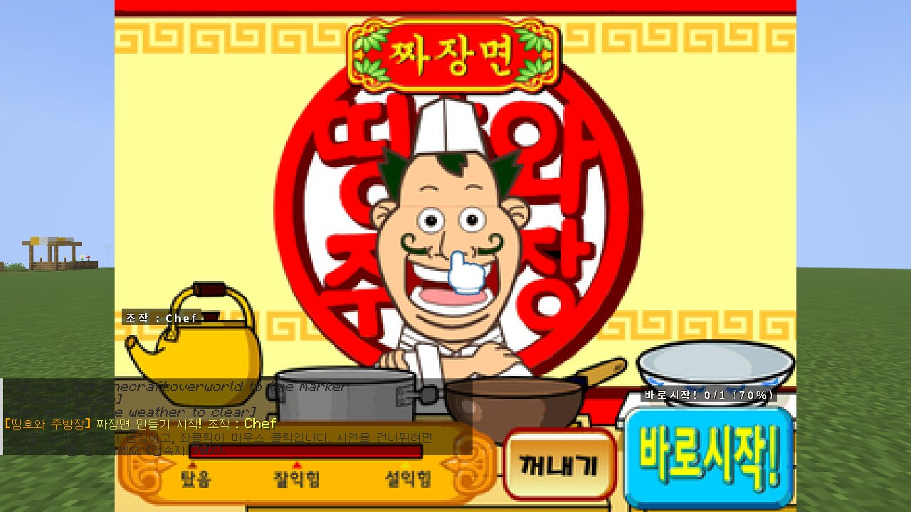
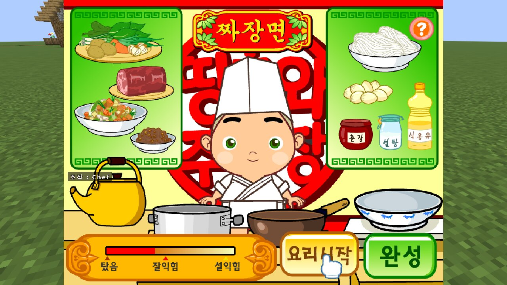
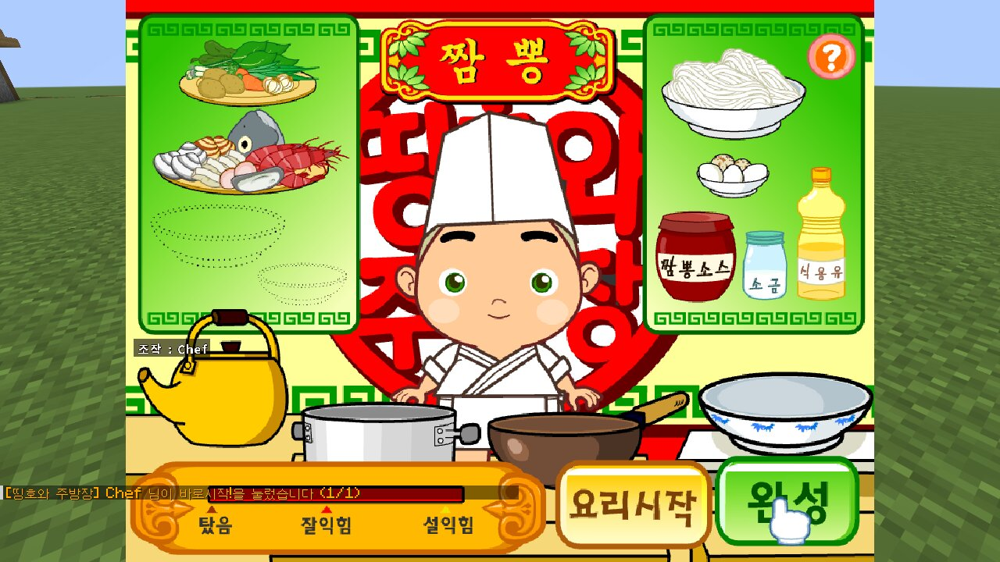
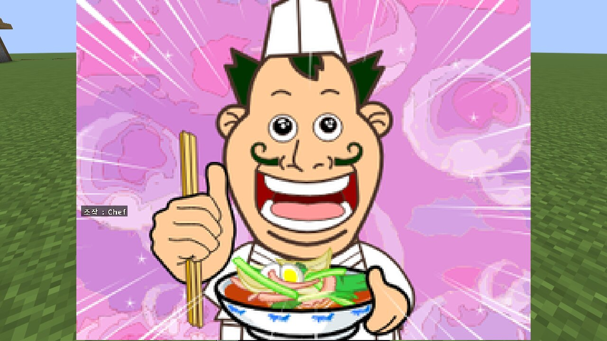

# 띵호와 주방장 1·2 — 짜장면 / 짬뽕 만들기 (마인크래프트 26.3)

game-kingdom.tistory.com 에 올라온 플래시 게임 두 개를 SWF에서 추출·분석해서 **Paper 26.3 서버 플러그인 + 리소스팩**으로 다시 만든 프로젝트입니다.

| 번호 | 게임 | 원본 |
|---|---|---|
| 1 | 띵호와 주방장1 **짜장면** 만들기 | [game-kingdom.tistory.com/256](https://game-kingdom.tistory.com/256) |
| 2 | 띵호와 주방장2 **짬뽕** 만들기 | [game-kingdom.tistory.com/257](https://game-kingdom.tistory.com/257) |

- 브라우저나 플래시 에뮬레이터를 쓰지 않습니다. 게임 로직은 원본 ActionScript를 디컴파일해 Java로 옮겼고, 그림과 소리는 모두 리소스팩에 들어 있습니다.
- 게임 화면은 월드에 세운 평면이 아니라 **플레이어 화면 위 UI(HUD)**에 뜹니다. 원본 550×413 화면이 **클라이언트 화면 세로에 꽉 차게** 그려지고, 창 크기·GUI 배율과 상관없이 정확히 맞습니다.
- 게임 중에는 **플레이어 손이 보이지 않고**, 원본 게임의 손가락 커서 이미지가 마우스 커서로 나옵니다.
- 명령어로 시작합니다. SayHi 로고·커튼·타이틀 인트로는 생략하고, 메뉴 화면부터 **주방장 시연**이 게임 안에서 재생됩니다.
- 시연 중에는 **접속자 전체의 70%가 「바로시작!」을 클릭하면** 시연을 건너뛰고 바로 요리가 시작됩니다. 투표 현황(`바로시작! 2/3 (70%)`)이 버튼 위에 뜨고, 누가 눌렀는지 채팅으로 알려 줍니다.
- 마우스를 움직이고 클릭하는 **조작자는 1명**이고, 좌측 상단 재료 패널 아래에 **`조작 : (플레이어명)`** 이 표시됩니다. 다른 플레이어는 같은 화면을 구경합니다.
- 두 게임에서 겹치는 그림(냄비·주전자·팬·버튼·커서 등)은 리소스팩 안의 같은 글리프를 함께 씁니다.
- 보너스: **띵호와 주방장 가면**(얼굴 앞 평면, 머리보다 큰 전체 얼굴), **심사 장면 주방장 고개 흔들기 애니메이션**(PNG + 딜레이 명시 파일).

▶ 플레이 영상 (실제 26.3 클라이언트, 시연 → 「바로시작!」 투표 → 요리 → 만점 엔딩 → 다시하기):
[`docs/ddinghowa1_jjajang.mp4`](docs/ddinghowa1_jjajang.mp4) · [`docs/ddinghowa2_jjamppong.mp4`](docs/ddinghowa2_jjamppong.mp4)
(소리는 서버의 효과음 재생 기록으로 합성)

| 시연 · 바로시작! 투표 | 짜장면 | 짬뽕 |
|---|---|---|
|  |  |  |

| 짬뽕 엔딩 | 주방장 가면 |
|---|---|
|  |  |

## 설치

1. `dist/DdinghowaChef-1.0.0.jar` 를 Paper **26.3** 서버(Java 25)의 `plugins/` 에 넣고 서버를 켭니다.
2. 리소스팩(게임 그림·셰이더·효과음)은 접속하는 플레이어에게 자동으로 보냅니다. **반드시 받아야** 게임이 보입니다.
   - 플러그인 내장 HTTP 서버가 **8163 포트**에서 팩을 제공합니다. 외부 플레이어가 받으려면 이 포트를 열어 주세요.
   - 직접 호스팅하려면 서버 실행 후 생기는 `plugins/DdinghowaChef/ddinghowa_pack.zip` 을 올리고 `config.yml` 의 `resource-pack.public-url` 에 주소를 넣으세요.

## 명령어

`/ddinghowa` (별칭 `/jjajang`, `/띵호와`)

| 명령어 | 설명 |
|---|---|
| `/ddinghowa start [플레이어] [1\|2]` | 게임 시작. `1` 짜장면(기본), `2` 짬뽕. 지정한 플레이어(생략 시 본인)가 조작자 |
| `/ddinghowa stop` | 게임 종료 (화면을 닫고 손 아이템을 돌려줌) |
| `/ddinghowa restart` | 처음(시연)부터 |
| `/ddinghowa skip` | 시연 강제 건너뛰기 (관리자용, 평소엔 70% 투표) |
| `/ddinghowa control <플레이어>` | 조작자 변경 (`조작 :` 표시도 바뀜) |
| `/ddinghowa watch` | 내 화면에 게임 켜기/끄기 |
| `/ddinghowa mask [플레이어]` | 띵호와 주방장 가면 지급 (우클릭으로 착용) |
| `/ddinghowa pack` | 리소스팩 다시 받기 |

권한: `ddinghowa.admin`(시작/종료/조작자, 기본 OP), `ddinghowa.mask`(가면, 기본 OP)

## 조작법

- **고개를 돌리면 커서가 움직입니다**(마우스처럼). 위아래 약 70°가 화면 위 끝~아래 끝입니다. 화면 끝에서 더 돌리면 커서는 끝에 머물고, 돌아오면 바로 따라옵니다.
- **좌클릭 = 마우스 클릭** (우클릭도 동일)
- 재료는 **클릭해서 집고**, 냄비·팬·그릇 위에서 **다시 클릭해서 놓습니다** (원본의 드래그 앤 드롭).
- 게임 화면을 보는 동안에는 손에 보이지 않는 아이템을 쥐여 손이 그려지지 않게 하고, 블록 부수기·설치·핫바 바꾸기를 막습니다. 게임이 끝나면 원래 들고 있던 아이템을 그대로 돌려줍니다(서버가 꺼져도 다음 접속 때 복구).

### 짜장면 레시피 (만점 400)
1. 야채(＋고기) → 팬, 「요리시작」, 게이지 「잘익힘」 근처에서 「꺼내기」 → 야채볶음
2. 춘장 → 팬 → 볶음춘장
3. 야채볶음 접시 + 볶음춘장 접시 → 팬 → 짜장 (100 + 익힘)
4. 주전자 물 + 면 → 냄비 → 면 (100 + 익힘)
5. 면·짜장 접시 → 그릇 → 「완성」. 350점 초과 대성공 / 280 초과 보통 / 그 외 실패

### 짬뽕 레시피 (만점 460)
1. 야채 → 팬 → 야채볶음, 해물 → 팬 → 해물볶음
2. 야채볶음 접시 + 해물볶음 접시 → 팬 → 짬뽕 국물 (100 + 익힘)
3. 주전자 물 + 면 → 냄비 → 면 (100 + 익힘)
4. 양념(식용유·소금)을 팬에 넣을 때마다 +10, 30점까지 (넘치면 그만큼 감점)
5. 면·국물 → 그릇, 메추리알을 그릇에 올리면 +30 → 「완성」. 410점 초과 대성공 / 240 초과 보통 / 그 외 실패
- 짬뽕 게이지는 짜장면보다 짧습니다(139프레임 ≈ 4.6초, 91~111프레임이 100점).

## 설정 (`plugins/DdinghowaChef/config.yml`)

- `ui.everyone` — 모든 접속자 화면에 게임 표시(기본) / `false` 면 조작자만 (다른 사람은 `/ddinghowa watch`)
- `ui.cursor-fov` — 커서 감도 (고개를 몇 도 돌려야 화면 끝까지 가는지, 기본 70)
- `resource-pack.*` — 자동 전송, 포트, 외부 URL, 필수 여부
- `sound.*` — 효과음 켜기/끄기, 볼륨

## 심사 장면: 주방장 고개 흔들기 애니메이션

`docs/animations/chef_headshake/` — 엔딩 시작에서 주인공이 심사를 받으려고 짜장(짬뽕)을 들고 오는 동안, 테이블 뒤 주방장이 웃으며 고개를 좌우로 흔드는 반복 동작입니다. 원본 스프라이트(짜장면 cid 530 / 짬뽕 cid 531) 8프레임을 원본의 2배 해상도로 뽑았습니다.

- `chef_headshake_jjajang.gif`, `chef_headshake_jjamppong.gif` — **주방장만 누끼 딴 투명 배경 GIF** (무한 반복)
- `jjajang/`, `jjamppong/` 아래 `full`(전신)·`head`(머리만) — PNG 프레임(`chef_headshake_NN.png`), 가로 스프라이트 시트, 애니메이션 명시 파일 `chef_headshake.anim.json`, 미리보기 GIF

`anim.json` 의 `frames[].delay_ms` 가 각 프레임 표시 시간(원본 30fps 기준, 같은 그림이 이어지는 프레임은 합침: 67 → 67 → 133ms, 한 바퀴 0.27초)이고, `delay_ticks` 는 마인크래프트 틱(50ms) 단위입니다.

## 구현 내용

### 1. 게임 추출·분석
- SWF(`original/ddinghowa1.swf`, `original/ddinghowa2.swf`, 550×413 30fps AS2)를 직접 만든 파서·디컴파일러(`tools/extract/swflib.py`)로 풀었습니다 → `docs/decompiled_actionscript.txt`, `docs/decompiled_actionscript_2.txt`
- 두 게임은 같은 엔진입니다. `KitchenGame.java` 가 원본 함수(`CheckCooking`, `PutInMeterial`, `MetaGauge`, `CookMeterial`, `DishLader`, `GotoEnding` …)를 같은 이름·분기로 옮겼고, 짬뽕만 다른 부분(해물·메추리알·양념 점수·게이지 구간·레시피·엔딩 점수)을 분기합니다.

### 2. 그림 → 리소스팩 폰트 + 셰이더 (전체화면 UI)
- 게임 사전만 담은 미니 SWF로 각 오브젝트를 원하는 프레임에 고정해 투명 배경으로 렌더링했습니다(`tools/extract/assets_game.py`, `mini.py`, `cap.js`). 엔딩은 슬라이드, 시연은 재생 속도를 늦춰 6프레임마다 정확히 캡처한 뒤 키프레임 + 바뀐 영역으로 압축했습니다.
- 모든 그림을 240×240 이하 **폰트 글리프 타일**로 만들어 리소스팩 폰트(`ddinghowa:ui`)에 넣습니다(`tools/extract/build_ui_pack.py`).
- 서버는 화면 한 장을 **타이틀 텍스트 한 줄**로 보냅니다. 각 글리프의 글자 색에 스테이지 좌표와 신호 비트를 넣고(R·G = x·y 하위 8비트, B = `0xA_` + 상위 비트), 리소스팩의 `text.vsh` 셰이더가 신호가 있는 GUI 글리프만 골라 원본 좌표로 옮기면서 화면 세로에 꽉 차게 배율을 맞춥니다. 그 밖의 글자는 바닐라와 똑같이 그려집니다.
- 화면이 바뀔 때만(또는 3초마다) 다시 보내고, 시연 중에는 플레이어마다 자기 커서가 그려진 화면을 따로 보냅니다.

### 3. 사운드
- 효과음·배경음·시연 내레이션·엔딩 음악을 SWF의 MP3/ADPCM에서 OGG로 변환했습니다. 두 게임에서 같은 소리는 하나만 넣습니다.

## 다시 빌드하기

```bash
mvn package        # → target/DdinghowaChef-1.0.0.jar (Java 25)

# 리소스팩/에셋 재생성 (선택) — tools/extract 참고
#  1) cap.html 과 같은 폴더에 Ruffle 셀프호스트 파일(npm @ruffle-rs/ruffle)을 두고 HTTP 서버 실행
#  2) assets_game.py <g1|g2> 로 캡처 작업 생성 → cap.js 로 렌더링 (엔딩·시연도 같은 방식)
#  3) build_ui_pack.py ui_config.json build  → build/assets.json, build/ddinghowa_pack.zip 을 src/main/resources/ 로
```

※ 원본 게임의 저작권은 원저작자(SayHi Kids)에게 있습니다. 개인·비영리 서버에서 즐기는 용도로 만들었습니다.
